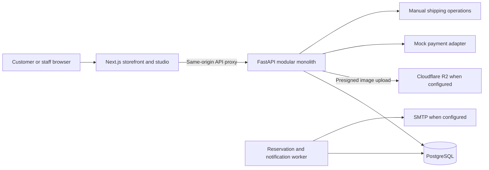

# Uyaras V1 architecture

Uyaras is a single-brand commerce preview built with Next.js, TypeScript, React, Tailwind CSS, shadcn/ui, FastAPI, Pydantic, SQLAlchemy 2 and PostgreSQL. The old HTML/JavaScript and JSON aggregate prototype is retained for reference, but the default launcher now uses the replacement application.

## Application boundaries

The [frontend](../frontend/) uses App Router server components for catalog pages, product metadata and policy content. Client components handle sessions, bags, checkout and staff forms. [The API](../backend/uyaras/main.py) validates requests with Pydantic and delegates catalog, security, checkout, media and provider behavior to separate modules. This is a modular monolith, not microservices.

[Database models](../backend/uyaras/models.py) store catalog, variants, inventory, cart items, orders, order items, reservations, payment attempts, webhook receipts, shipments, returns, refunds, COD reconciliation, sessions, audits and outbox jobs as separate relational rows. JSON is used for immutable order/address/totals snapshots, settings, eligibility lists and audit details, not one shared commerce record. Single-warehouse stock uses a primary location label; multi-location allocation is deferred. Fixed server-enforced role permissions simplify V1; arbitrary permission editing and multiple roles per user are not implemented.

The initial schema is frozen in [an SQL migration snapshot](../backend/alembic/versions/0001_schema.sql). Later revisions add operational fields and provider-reference uniqueness. The new schema does not read or import the disposable legacy SQLite data.

## Checkout and stock

1. Guest carts persist against a session. Registration/login merges the bag into the customer cart.
2. A signed-in customer chooses a saved address and payment method. The server checks an explicit PIN rule and computes a five-minute quote.
3. Prices are integer paise. Demo tax is included in displayed prices, not added again. Coupon eligibility, shipping, free-shipping threshold and COD fees are recomputed server-side.
4. Order creation locks the customer cart, quote, applicable promotion and individual SKU inventory rows. It verifies the snapshot, reserves stock and creates the order in one PostgreSQL transaction. A customer/idempotency-key constraint protects retries. Database dependencies use FastAPI's function scope so commits finish before a successful HTTP response is sent; see [FastAPI dependency lifecycle](https://fastapi.tiangolo.com/tutorial/dependencies/dependencies-with-yield/#early-exit-and-scope).
5. COD orders become Confirmed with payment due. Prepaid orders receive a fifteen-minute hold. Signed mock webhooks or explicit test controls determine payment results.
6. Expiry/failure releases holds once. Retry reacquires available inventory. Capture after expiration/cancellation enters manual reconciliation and cannot trigger fulfillment.
7. Dispatch consumes both on-hand and reserved quantities. Cancel before dispatch releases holds. Inspected return/RTO receipt can restock once.

Order items preserve names, SKU, size, colour, prices, quantity, allocated discount and included merchandise tax. Order totals separately preserve shipping and COD charges. Current catalog edits do not rewrite previous orders.

## State transitions

| Workflow | Enforced progression |
| --- | --- |
| COD fulfillment | Confirmed → Processing → Packed → Shipped → Delivered |
| Prepaid | Pending payment → Confirmed after verified mock capture; failure/expiry releases stock; retry returns to Pending payment |
| Cancellation | Customer request before dispatch enters Cancellation Requested; staff approval cancels, rejection restores the prior state; unpaid orders cancel immediately; captured funds require refund reconciliation |
| RTO | Shipped → Returning to origin → Returned to origin; inspected restock is optional |
| Shipment milestones | Picked up → In transit → Out for delivery; failed delivery permits another attempt; RTO in transit supported |
| Returns | Requested → Approved → optional Pickup arranged → Received → Closed, or Requested → Rejected |
| COD money | Due → Collected → Remitted, separate from physical delivery |
| Refunds | External payment/refund transfer is recorded with reference and amount; cumulative amount cannot exceed collected order total |

Manual exchanges are handled through a return request plus a referenced replacement order. V1 does not automatically allocate a replacement SKU or initiate a payment refund. Shipping labels and carrier webhooks require the selected provider integration.

## Security and operations

- Scrypt password hashing; hashed session/reset tokens; HttpOnly SameSite cookies; Secure cookies in production; session rotation; CSRF and origin checks.
- Server-side ownership and staff role checks. Owner creates staff access from existing accounts; changing roles invalidates sessions.
- Rate limiting for registration, login, recovery, session creation and sensitive checkout/order/admin mutations. Consistent error envelopes include a request ID. API responses hide passwords and reset messages. Request logs use route templates, status and duration, excluding bodies, query strings and customer details.
- R2 uploads use short-lived signed PUT URLs. Confirmation checks object size, MIME and image decoding before recording metadata. R2 credentials remain server-side. No live R2 account was created.
- Outbox delivery uses leases, retries and stable message IDs. SMTP delivery is at least once, so rare duplicate notifications remain possible after a crash. Without SMTP, jobs remain pending.
- Reservation expiry runs independently in the worker. Keep it running alongside the backend.
- Public catalog responses favor freshness with no-store fetching. Category/collection metadata alone can opt into a bounded TTL; price and stock remain fresh. Catalog and administrative collection queries use server-side pagination/search. Production load testing remains a launch task.

## API and provider contracts

Interactive OpenAPI is available at `http://127.0.0.1:8001/docs`; machine-readable schema at `/openapi.json`. Main API paths use `/api/v1`. The PRD's route outline is represented by equivalent workflows, not exact one-for-one URL aliases: cart quantity upsert/removal uses `/cart/items`, manual order actions use `/admin/orders/{id}`, and recovery uses `/auth/forgot` and `/auth/reset`.

[Provider adapters](../backend/uyaras/providers.py) default to `PAYMENT_PROVIDER=mock` and `SHIPPING_PROVIDER=manual`. Unknown adapters fail closed. Real provider selection requires implementing and verifying the gateway create/verify/refund/webhook and carrier serviceability/label/tracking contracts. Merely entering a provider name never activates live sales.

## Production gate

The catalog seed creates zero stock. `demo-stock` adds explicitly simulated inventory only outside production. Production ordering remains server-blocked even if configuration fields are changed. Before removing that gate, verify actual stock, real products/images/prices, GST treatment, policies, support and warehouse details, PIN coverage, payment/shipping providers, HTTPS, monitoring, backups and operational acceptance. The current preview is not a live trading site.
